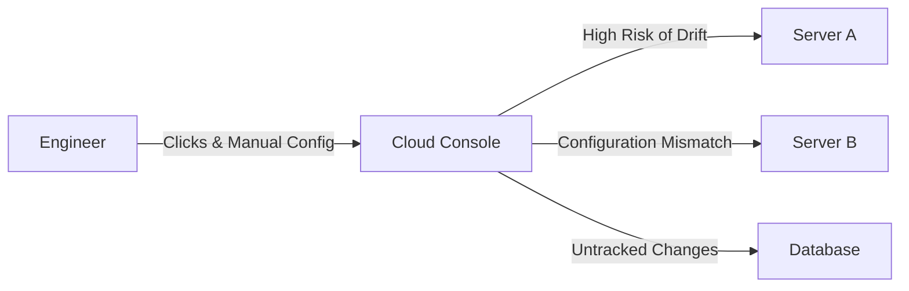
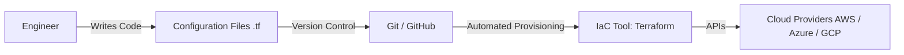
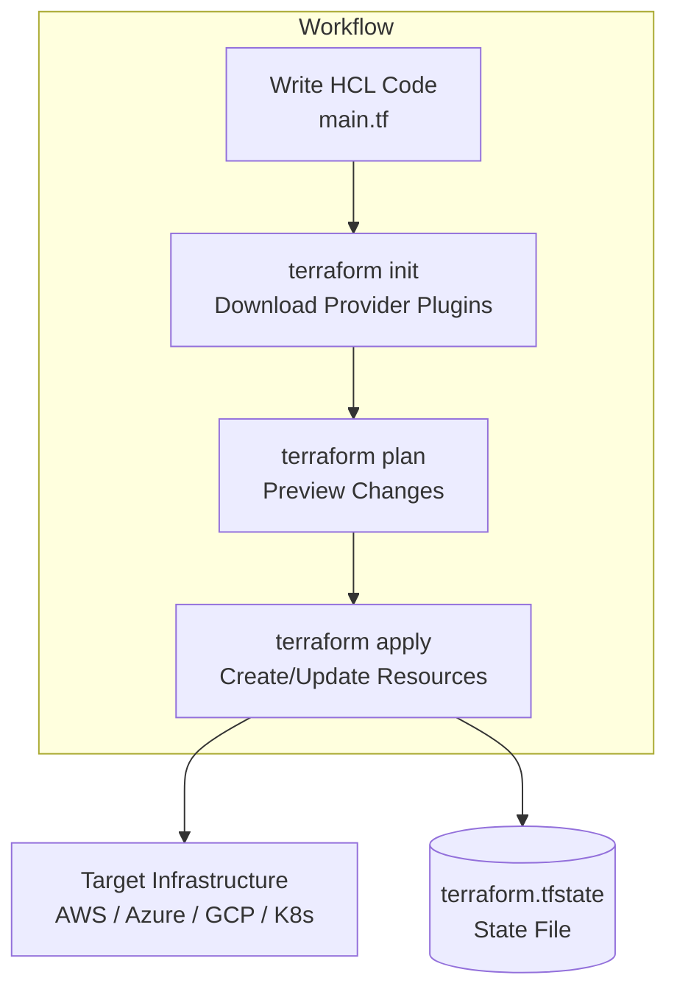

# Day 0: Introduction to Terraform & Infrastructure as Code (IaC)

Welcome to **Day 0** of your Terraform learning journey! This guide covers the fundamentals of Infrastructure as Code, why manual infrastructure setup is problematic, what Terraform is, how to install it across different operating systems, and key Terraform commands to get started.

---

## 1. Challenges of Manual Infrastructure Creation

In the traditional way of managing infrastructure (before IaC), engineers logged into cloud consoles (AWS, Azure, GCP) or bare-metal servers and clicked buttons, filled forms, or ran one-off shell scripts manually.



### Key Problems with Manual Setup:
1. **Human Error**: Easy to misconfigure firewall rules, forget security group entries, or select the wrong machine sizing.
2. **Lack of Consistency & Configuration Drift**: Development, Staging, and Production environments often drift apart because someone made an untracked change directly in the console.
3. **Slow & Non-Scalable**: Setting up 50 servers, VPCs, subnets, and load balancers manually takes days or weeks.
4. **No Audit Trail or History**: It is difficult to track who changed what, when, and why without deep log digging.
5. **Difficult Disaster Recovery**: Rebuilding entire environments from memory or outdated runbooks during an outage is error-prone and stressful.

---

## 2. What is Infrastructure as Code (IaC)?

**Infrastructure as Code (IaC)** is the practice of managing, provisioning, and configuring servers, networks, databases, and other infrastructure components using **machine-readable definition files (code)** rather than manual console clicking or physical hardware configuration.



### Benefits of IaC:
- **Reproducibility**: Spin up identical development, staging, and production environments with a single command.
- **Version Controlled**: Store your infrastructure code in Git to review changes, collaborate via pull requests, and rollback mistakes quickly.
- **Speed & Automation**: Automate repetitive infrastructure tasks in your CI/CD pipelines.
- **Self-Documenting**: The code serves as living documentation of your entire architecture.

---

## 3. What is Terraform?

**Terraform** is an open-source Infrastructure as Code (IaC) software tool created by **HashiCorp**. It enables you to define both cloud and on-premises resources in human-readable configuration files written in **HCL (HashiCorp Configuration Language)**.

Terraform is **cloud-agnostic**, meaning you can manage multiple cloud providers (AWS, Azure, Google Cloud, Kubernetes, GitHub, Cloudflare, etc.) using the exact same workflow and syntax.

### How Terraform Works:


---

## 4. Advantages of Terraform

| Advantage | Explanation |
| :--- | :--- |
| **Declarative Syntax** | You describe *what* you want the desired end-state to be, and Terraform figures out *how* to achieve it. |
| **Multi-Cloud Support** | Use one tool and one language across AWS, GCP, Azure, Oracle Cloud, VMware, and SaaS platforms. |
| **State Management** | Keeps track of real-world resources using a state file (`terraform.tfstate`) to detect changes and prevent unwanted drift. |
| **Execution Plan (Dry-Run)** | `terraform plan` shows exactly what resources will be created, updated, or destroyed before making changes. |
| **Massive Ecosystem & Registry** | Thousands of official, verified, and community providers and reusable modules available on the Terraform Registry. |
| **Modularity & Reusability** | Break complex infrastructure into reusable modules for different teams and environments. |

---

## 5. IaC Example (HCL Code)

Here is a simple example showing how infrastructure is defined in Terraform using HashiCorp Configuration Language (HCL).

### `main.tf`
```hcl
# 1. Define the Required Provider
terraform {
  required_version = ">= 1.0.0"
  required_providers {
    aws = {
      source  = "hashicorp/aws"
      version = "~> 5.0"
    }
  }
}

# 2. Configure the Provider
provider "aws" {
  region = "us-east-1"
}

# 3. Define Resources to Create
resource "aws_vpc" "main_vpc" {
  cidr_block           = "10.0.0.0/16"
  enable_dns_hostnames = true

  tags = {
    Name        = "my-first-vpc"
    Environment = "Dev"
  }
}

resource "aws_subnet" "public_subnet" {
  vpc_id            = aws_vpc.main_vpc.id
  cidr_block        = "10.0.1.0/24"
  availability_zone = "us-east-1a"

  tags = {
    Name = "public-subnet-1"
  }
}
```

*Explanation:*
- **`terraform {}` block**: Specifies required versions and downloads the AWS provider plugin.
- **`provider "aws" {}` block**: Configures credentials and region for the target cloud.
- **`resource` blocks**: Declares the desired infrastructure components (VPC and Subnet), linking them together seamlessly (`aws_vpc.main_vpc.id`).

---

## 6. How to Install Terraform

### Option A: macOS Installation

#### 1. Using Package Manager (Homebrew - Recommended)
```bash
# Add HashiCorp tap
brew tap hashicorp/tap

# Install Terraform
brew install hashicorp/tap/terraform
```

#### 2. Manual Binary Download (v1.17.2)
- **Intel (AMD64)**: [Download terraform_1.17.2_darwin_amd64.zip](https://releases.hashicorp.com/terraform/1.17.2/terraform_1.17.2_darwin_amd64.zip)
- **Apple Silicon (ARM64 / M1/M2/M3)**: [Download terraform_1.17.2_darwin_arm64.zip](https://releases.hashicorp.com/terraform/1.17.2/terraform_1.17.2_darwin_arm64.zip)

**Manual Setup Steps:**
```bash
# Extract archive and move binary to PATH
unzip terraform_1.17.2_darwin_*.zip
sudo mv terraform /usr/local/bin/
```

---

### Option B: Windows Installation

#### 1. Using Package Manager (Winget / Chocolatey / Scoop)
```powershell
# Using Winget (Built-in on Windows 10/11)
winget install HashiCorp.Terraform

# OR using Chocolatey
choco install terraform

# OR using Scoop
scoop install terraform
```

#### 2. Manual Binary Download (v1.17.2)
- **Windows 64-bit (AMD64 - Most Common)**: [Download terraform_1.17.2_windows_amd64.zip](https://releases.hashicorp.com/terraform/1.17.2/terraform_1.17.2_windows_amd64.zip)
- **Windows 32-bit (386)**: [Download terraform_1.17.2_windows_386.zip](https://releases.hashicorp.com/terraform/1.17.2/terraform_1.17.2_windows_386.zip)
- **Windows ARM64**: [Download terraform_1.17.2_windows_arm64.zip](https://releases.hashicorp.com/terraform/1.17.2/terraform_1.17.2_windows_arm64.zip)

**Manual Setup Steps:**
1. Download and extract the `.zip` file (e.g., extract `terraform.exe` to `C:\terraform`).
2. Add `C:\terraform` to your System Environment Variable `PATH`:
   - Open **Start** > search **Environment Variables**.
   - Edit the **Path** variable under User or System variables and add `C:\terraform`.
3. Open a new Command Prompt or PowerShell and verify.

---

### Option C: Linux Installation

#### 1. Using Package Manager (Ubuntu / Debian)
```bash
# Ensure system is updated and required dependencies are installed
sudo apt-get update && sudo apt-get install -y gnupg software-properties-common curl

# Add HashiCorp GPG key
wget -O - https://apt.releases.hashicorp.com/gpg | sudo gpg --dearmor -o /usr/share/keyrings/hashicorp-archive-keyring.gpg

# Add HashiCorp repository
echo "deb [arch=$(dpkg --print-architecture) signed-by=/usr/share/keyrings/hashicorp-archive-keyring.gpg] https://apt.releases.hashicorp.com $(grep -oP '(?<=UBUNTU_CODENAME=).*' /etc/os-release || lsb_release -cs) main" | sudo tee /etc/apt/sources.list.d/hashicorp.list

# Update package list and install Terraform
sudo apt update && sudo apt install -y terraform
```

#### 2. Using Package Manager (CentOS / RHEL / Fedora / Amazon Linux)
```bash
# CentOS / RHEL
sudo yum install -y yum-utils
sudo yum-config-manager --add-repo https://rpm.releases.hashicorp.com/RHEL/hashicorp.repo
sudo yum install -y terraform

# Fedora
sudo dnf install -y dnf-plugins-core
sudo dnf config-manager --add-repo https://rpm.releases.hashicorp.com/fedora/hashicorp.repo
sudo dnf install -y terraform

# Amazon Linux
sudo yum install -y yum-utils
sudo yum-config-manager --add-repo https://rpm.releases.hashicorp.com/AmazonLinux/hashicorp.repo
sudo yum install -y terraform
```

#### 3. Manual Binary Download (v1.17.2)
- **Linux AMD64 (64-bit)**: [Download terraform_1.17.2_linux_amd64.zip](https://releases.hashicorp.com/terraform/1.17.2/terraform_1.17.2_linux_amd64.zip)
- **Linux ARM64**: [Download terraform_1.17.2_linux_arm64.zip](https://releases.hashicorp.com/terraform/1.17.2/terraform_1.17.2_linux_arm64.zip)
- **Linux ARM**: [Download terraform_1.17.2_linux_arm.zip](https://releases.hashicorp.com/terraform/1.17.2/terraform_1.17.2_linux_arm.zip)
- **Linux 386 (32-bit)**: [Download terraform_1.17.2_linux_386.zip](https://releases.hashicorp.com/terraform/1.17.2/terraform_1.17.2_linux_386.zip)

**Manual Setup Steps:**
```bash
unzip terraform_1.17.2_linux_*.zip
sudo mv terraform /usr/local/bin/
```

---

### Verify Installation
Run the following command in any terminal (macOS, Windows PowerShell, or Linux):
```bash
terraform -version
```
**Expected Output:**
```text
Terraform v1.17.2
on ...
```

---

## 7. Essential Terraform Commands

| Command | Purpose | When to Use |
| :--- | :--- | :--- |
| `terraform init` | Initializes the working directory, downloads provider plugins, and sets up backend. | Run once at project setup or whenever providers/modules change. |
| `terraform validate` | Validates syntax and internal consistency of configuration files. | Run before planning to catch syntax or configuration errors. |
| `terraform fmt` | Rewrites config files into canonical format and style (auto-formatting). | Run before committing code to version control. |
| `terraform plan` | Generates and previews an execution plan without modifying actual infrastructure. | Run to verify changes before applying them. |
| `terraform apply` | Provisions or updates the infrastructure as defined in the configuration. | Run to execute changes on target infrastructure (`-auto-approve` skips confirmation). |
| `terraform show` | Inspects current state or a saved plan file in human-readable format. | Run to view details of provisioned resources. |
| `terraform destroy` | Destroys all remote objects managed by the current Terraform configuration. | Run when tearing down dev/test environments to stop incurring costs. |
| `terraform state list` | Lists all resources tracked in the Terraform state file. | Run to quickly view managed resource names. |
| `terraform output` | Displays outputs defined in configuration files. | Run to see values like public IPs or DNS names after deployment. |

---

## Next Steps
Congratulations on finishing Day 0! You now understand IaC fundamentals, why Terraform is the industry standard, how to install it, and basic commands. Proceed to Day 1 to build your first live infrastructure project!
