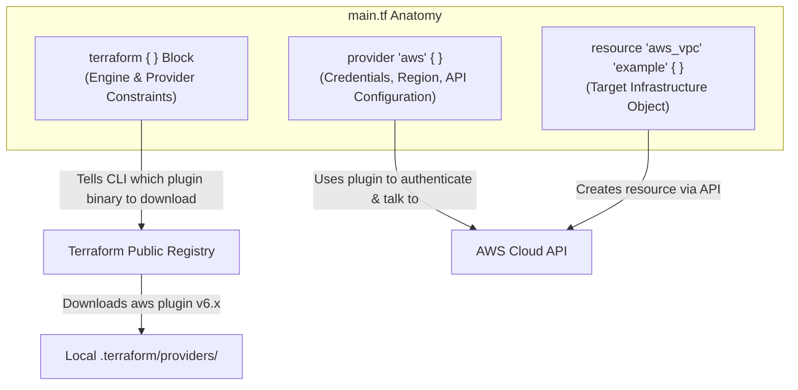
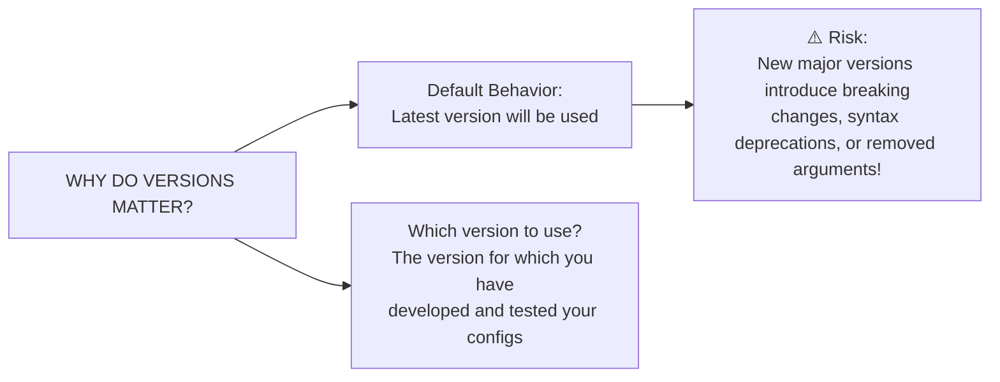
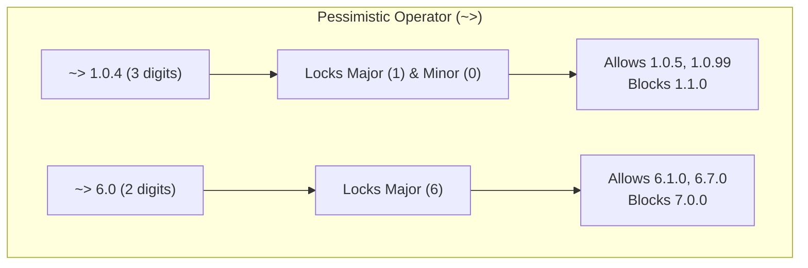

# Day 01: Terraform Core Blocks, Providers & Version Constraints

Welcome to **Day 01** of our Terraform journey! This module breaks down the anatomy of a Terraform configuration file, explains how Providers work, details why version locking is critical in production, and demystifies version constraint operators—key knowledge tested in the **HashiCorp Certified: Terraform Associate** exam and technical DevOps interviews.

---

## 📑 Official Documentation Reference
- **AWS Provider Official Docs:** [HashiCorp AWS Provider on Terraform Registry](https://registry.terraform.io/providers/hashicorp/aws/latest/docs)

---

## 1. Complete Architecture & Code Breakdown

Here is our baseline configuration that provisions an AWS VPC:

```hcl
# 1. Terraform Settings Block (Core Configuration)
terraform {
  required_version = ">= 1.0.0" # Terraform CLI / Core version constraint

  required_providers {
    aws = {
      source  = "hashicorp/aws" # Registry namespace and provider name
      version = "~> 6.0"        # Provider version constraint
    }

    random = {
      source  = "hashicorp/random"
      version = "~> 3.1"        # Utility provider to generate random IDs/names
    }
  }
}

# 2. Provider Configuration Block (Authentication & Settings)
provider "aws" {
  region = "us-east-1" # Hardcoded region for demo
}

# 3. Resource Block (The Infrastructure to Provision)
resource "aws_vpc" "example" {
  cidr_block = "10.0.0.0/16"

  tags = {
    Name = "day-01-vpc"
  }
}
```



---

## 2. Understanding the 3 Core Blocks

### Block 1: `terraform { ... }` (Terraform Settings Block)
- **Role**: Configures global settings for Terraform itself. It does **not** create any infrastructure.
- **`required_version`**: Specifies which version of the **Terraform Core CLI** is allowed to run this code (e.g. `terraform -v`).
- **`required_providers`**: Declares which plugins (providers) are needed and where to fetch them.
  - **`source`**: The global address of the provider:
    - Format: `[<HOSTNAME>/]<NAMESPACE>/<TYPE>`
    - Default Hostname: `registry.terraform.io` (omitted if using the official registry).
    - Example: `"hashicorp/aws"` $\rightarrow$ Namespace: `hashicorp`, Type: `aws`.
    - Partner example: `"datadog/datadog"`.
  - **`version`**: Specifies which plugin version to download.

### Block 2: `provider "aws" { ... }` (Provider Block)
- **Role**: Configures the specific provider plugin downloaded during `terraform init`.
- It sets credentials, cloud regions (`us-east-1`), endpoints, or assume-role configurations.
- You can have multiple provider blocks (e.g., multi-region or multi-account deployments using `alias`).

### Block 3: `resource "aws_vpc" "example" { ... }` (Resource Block)
- **Syntax**: `resource "<PROVIDER>_<TYPE>" "<LOCAL_NAME>"`
  - `aws_vpc`: The resource type recognized by the AWS provider.
  - `example`: Local identifier used to reference this resource elsewhere in Terraform code.
- **Parameters**: Attributes required by the API (like `cidr_block = "10.0.0.0/16"`).

---

## 3. Why Versioning Matters



### The Production Risk:
1. If you omit the `version` constraint, `terraform init` automatically downloads the **latest** available provider release.
2. Cloud providers evolve rapidly. When a provider bumps from `v5.x` to `v6.x` (Major Release), deprecated attributes are removed, default behaviors change, and previously working code will **break**.
3. **Best Practice**: Always pin both the **Terraform Core version** and all **Provider versions** to prevent unexpected pipeline failures.

---

## 4. Terraform Version Constraints Deep Dive

Version strings follow **Semantic Versioning (SemVer)**: `MAJOR.MINOR.PATCH` (e.g., `6.7.0`).

```
    6    .    7    .    0
    │         │         │
    ▼         ▼         ▼
  MAJOR     MINOR     PATCH
(Breaking) (Features) (Bug fixes)
```

In Terraform, version constraints consist of an **Operator** and a **Version**:
$$\text{Constraint} = \underbrace{\text{Operator}}_{\text{e.g. } \sim>,\, \ge} + \underbrace{\text{Version Number}}_{\text{e.g. } 6.0,\, 1.0.4}$$

### Supported Operators Summary:

| Operator | Meaning | Example | Permitted Versions | Blocked Versions |
| :--- | :--- | :--- | :--- | :--- |
| `=` *(or bare)* | Exact version only | `"= 6.7.0"` | `6.7.0` | `6.7.1`, `6.6.9` |
| `!=` | Exclude an exact version | `!= 6.7.1` | Any except `6.7.1` | `6.7.1` |
| `>`, `>=` | Greater than / Greater or equal | `">= 1.0.0"` | `1.0.0`, `1.5.0`, `2.0.0` | `0.15.0` |
| `<`, `<=` | Less than / Less or equal | `"< 2.0.0"` | `1.9.9`, `1.14.0` | `2.0.0`, `2.1.0` |
| `~>` | **Pessimistic constraint operator** | Explained below | Allows rightmost digit to increment | Freezes left digits |

---

## 5. The Pessimistic Constraint Operator (`~>`) Explained

The **pessimistic operator (`~>`)** is the most frequently asked versioning concept in certifications and interviews.

> **Rule of Thumb**: `~>` locks down all parts of the version number **except the rightmost specified number**, which can increase.

### Scenario A: Three segments specified (`~> 1.0.4`)
- The rightmost number is the **PATCH** (`4`).
- Terraform allows **Patch upgrades** only.
- ✅ Allowed: `1.0.4`, `1.0.5`, `1.0.10`
- ❌ Blocked: `1.1.0` (Minor version bumped), `2.0.0` (Major version bumped)

### Scenario B: Two segments specified (`~> 6.0` or `~> 1.1`)
- The rightmost number is the **MINOR** (`0` or `1`).
- Terraform allows **Minor and Patch upgrades**.
- ✅ Allowed: `6.0.0`, `6.1.0`, `6.7.0`, `6.99.0`
- ❌ Blocked: `7.0.0` (Major version bumped $\rightarrow$ prevents breaking changes!)



---

## 6. What Happens During `terraform init`?

When you run `terraform init`:
1. **Plugin Download**: Terraform inspects `required_providers`, contacts `registry.terraform.io`, downloads the matching OS binary (e.g. `terraform-provider-aws_v6.x`), and stores it in the `.terraform/` folder.
2. **Dependency Lock File (`.terraform.lock.hcl`)**:
   - Terraform automatically creates or updates this file.
   - It records the exact version downloaded and cryptographic checksums (hashes) for multi-platform integrity.
   - **Certification Note**: Always commit `.terraform.lock.hcl` to version control (Git) so all team members and CI/CD runners use identical binaries.

---

## 7. Interview & Certification Q&A (Cheat Sheet)

### Q1: What is the difference between `required_version` and `version` inside `required_providers`?
> **Answer**: 
> - `required_version` restricts the **Terraform Core CLI** version (e.g. Terraform v1.5 vs v1.17).
> - `version` inside `required_providers` restricts the **Provider plugin** version (e.g. AWS Provider v5 vs v6).

### Q2: What does `version = "~> 3.2.0"` permit?
> **Answer**: It permits `>= 3.2.0` and `< 3.3.0`. It only allows patch releases (`3.2.1`, `3.2.5`), preventing minor or major version changes.

### Q3: Why is hardcoding credentials inside the `provider` block considered an anti-pattern?
> **Answer**: Storing `access_key` and `secret_key` in plaintext inside configuration files poses severe security risks. The industry standard is to use environment variables (`AWS_ACCESS_KEY_ID`, `AWS_SECRET_ACCESS_KEY`), AWS IAM Roles (for EC2/EKS/GitHub Actions), or AWS CLI profiles (`~/.aws/credentials`).

### Q4: What is the purpose of the `.terraform.lock.hcl` file?
> **Answer**: It is the **Dependency Lock File**. It locks the exact provider versions and their cryptographic checksums used in the configuration, ensuring consistency across different machines, team members, and CI/CD pipelines.

---

## 8. Hands-On Step-by-Step Exercise

1. Create your `main.tf` file using the baseline configuration shown in Section 1.
2. Initialize the directory:
   ```bash
   terraform init
   ```
3. Validate your code syntax:
   ```bash
   terraform validate
   ```
4. Format the code:
   ```bash
   terraform fmt
   ```
5. Preview the infrastructure creation:
   ```bash
   terraform plan
   ```
