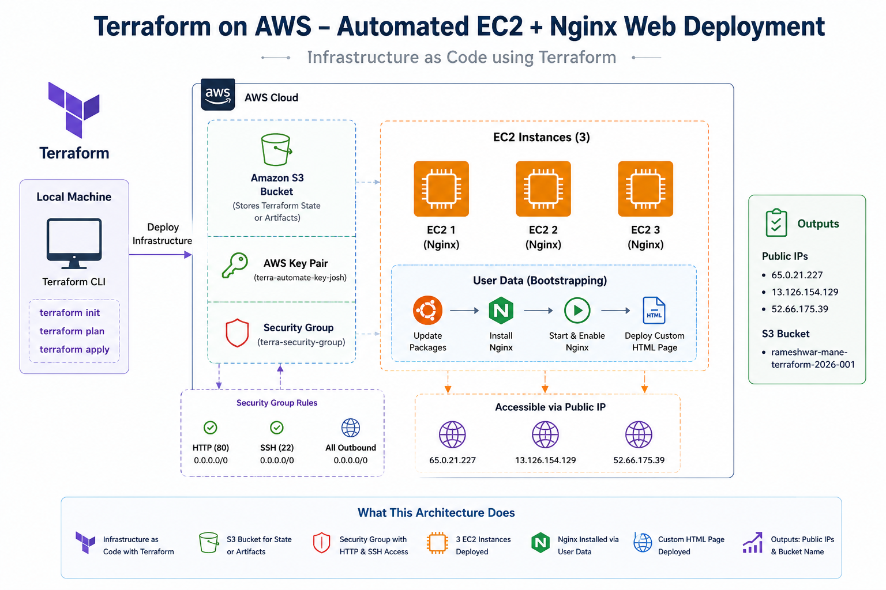

# 🚀 Terraform AWS EC2 + Nginx Deployment

Provision AWS infrastructure using **Terraform (Infrastructure as Code)**.

This project automatically creates:

- Amazon S3 Bucket
- AWS Key Pair
- Default VPC
- Security Group
- Three EC2 Instances
- Automatic Nginx Installation
- Custom Static HTML Website

---

# Architecture



---

# Technologies

- Terraform
- AWS EC2
- AWS S3
- AWS Security Groups
- AWS Key Pair
- Ubuntu
- Nginx
- Bash (User Data)

---

# Project Structure

```text
terraform-aws-ec2-nginx/
│
├── provider.tf
├── versions.tf
├── variables.tf
├── terraform.tfvars.example
├── main.tf
├── outputs.tf
├── userdata.sh
├── README.md
├── .gitignore
└── images/
```

---

# Prerequisites

- AWS Account
- AWS CLI
- Terraform
- Git
- SSH

---

# Configure AWS

```bash
aws configure
```

Provide

```
Access Key
Secret Key
Region (ap-south-1)
Output format (json)
```

---

# Generate SSH Key

```bash
ssh-keygen -t rsa -b 4096 -f terra-automate-key
```

---

# Terraform Workflow

Initialize

```bash
terraform init
```

Format

```bash
terraform fmt
```

Validate

```bash
terraform validate
```

Execution Plan

```bash
terraform plan
```

Deploy

```bash
terraform apply
```

Destroy Infrastructure

```bash
terraform destroy
```

---

# Resources Created

- S3 Bucket
- AWS Key Pair
- Security Group
- 3 EC2 Instances
- Nginx Web Server
- Custom HTML Website

---

# Outputs

Terraform displays

```
Bucket Name

Public IPs

EC2 Instance IDs
```

---

# Access Website

```
http://<EC2-Public-IP>
```

---

# Security Group Rules

| Port | Protocol | Purpose |
|-------|----------|----------|
|22|TCP|SSH|
|80|TCP|HTTP|
|All|Outbound|Internet Access|

---

# User Data

The EC2 instance automatically

- Updates packages
- Installs Nginx
- Enables Nginx
- Starts Nginx
- Deploys custom HTML page

---

# Architecture Flow

Terraform

↓

AWS

├── S3 Bucket

├── Security Group

├── Key Pair

└── EC2 (3)

↓

User Data

↓

Install Nginx

↓

Deploy HTML

↓

Public IP

---

# Future Improvements

- Custom VPC
- Public & Private Subnets
- Internet Gateway
- NAT Gateway
- Load Balancer
- Auto Scaling
- Remote Backend
- DynamoDB State Locking
- Jenkins CI/CD Pipeline

---

# Author

**Rameshwar Mane**

AWS Certified Cloud Practitioner

DevOps Enthusiast

MERN Stack Developer